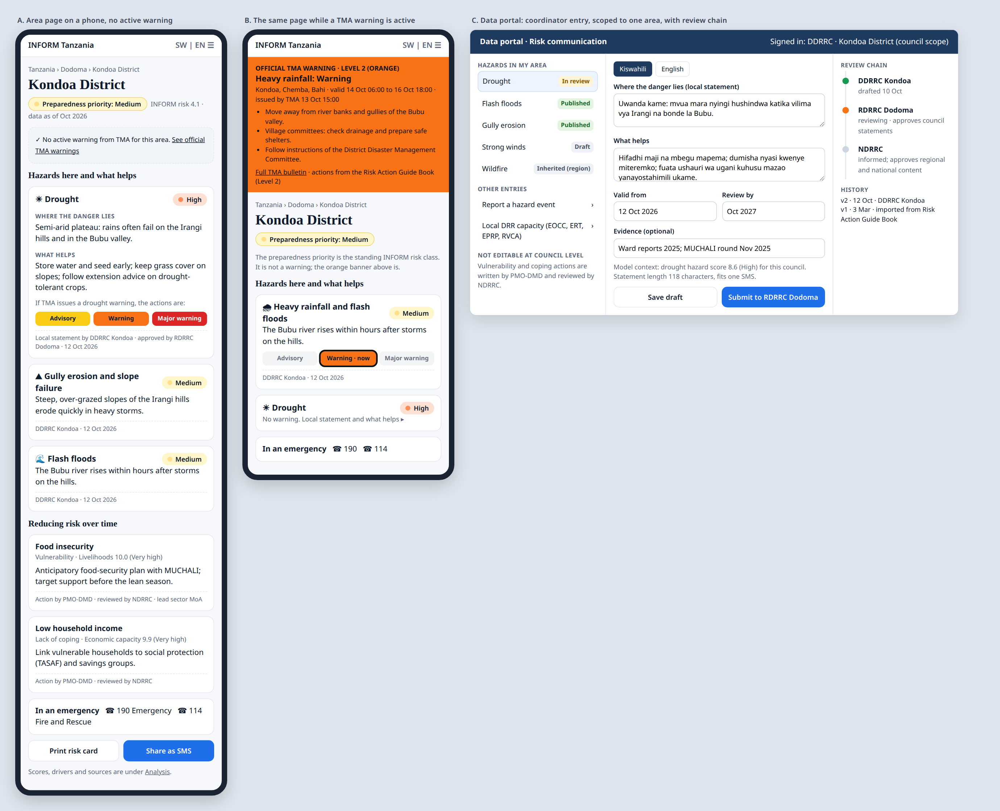

# INFORM Tanzania: interface and risk communication review

Reviewed 9 October 2026 on the production build (commit df12dbb, identical to the live site). Every page was rendered in a headless browser at 1,440 px and 390 px with lazily loaded charts mounted, and each section was measured (height, words, charts, tables). Evidence screenshots are in `screens/`; the proposed design is in `mockups/`. Issues, decisions and the roadmap are in `INFORM_TZ_Issue_Matrix_2026-10.xlsx` (sheets 'Issues', 'UI review', 'Risk communication', 'Roles (RACI)', 'Hazard crosswalk').

## 1. Who the site is for, and what each needs

| Audience | What they need from the site |
|---|---|
| Communities and the public (often through a DDRRC) | Which hazards affect my area, what helps, what to do if a warning is issued; short, local, in Kiswahili, on a phone. |
| District and regional DRR coordinators (DDRRC, RDRRC) | The risk profile of their council or region and why; local guidance they can keep current; a way to report events. |
| National coordination (NDRRC, PMO-DMD, management) | Where to prioritise, how regions compare, what changed, what to brief. |
| Data institutions (NBS, TMA, MoH ...) | Their indicators, open requests, an easy way to send figures. |
| Analysts, partners, reviewers | Method, sources and evidence they can check and reproduce. |

## 2. What the site shows today

| Page | Desktop height | Phone height | Sections | Words | Charts / maps / tables |
|---|---|---|---|---|---|
| Home | 5,621 px | 6,356 px | 6 | 500 | map, 1 table |
| Risk explorer | full screen | full screen | - | 219 | map, table view |
| Area profile (council) | 15,867 px | 19,241 px | 9 | 3,600 | 3 charts, map, 2 tables |
| Area profile (region) | 17,111 px | 21,670 px | 9 | 4,100 | 3 charts, map, 2 tables |
| Insights | 12,182 px | 17,729 px | 9 | 2,900 | 7 charts, map, matrix |
| Crisis severity | 12,224 px | 17,608 px | 9 | 2,200 | map, 21 inputs, table |
| Learn (per lesson) | 6,847 px | 7,414 px | 7 | 900 | widgets, quiz |
| Methodology | 27,123 px | 39,994 px | 13 | 7,062 | 4 tables |
| Data portal (signed out) | 1,833 px | 2,683 px | 2 | 141 | - |

The explorer is compact and works well. Most of the length is in the area profiles and Methodology. On a phone, the public guidance on an area profile starts about 2,550 px (three screens) down, after rank, population, area, map and key findings (`screens/06_area_profile_mobile_top.png`).

## 3. Is everything necessary?

No. About a third of each area profile repeats content found elsewhere, and several displays carry the integrity problems of the main assessment to every page. The verdict for each section:

| Page | Section | Height | Verdict | Reason |
|---|---|---|---|---|
| Home | Hero, map and KPIs | about 1,000 | **Keep, correct** | National KPI is Kondoa's row (NAT-01). |
| Home | Risk is where hazard, vulnerability and weak coping capacity meet | 528 | **Simplify** | Keep 3 short cards; drop the national equation until NAT-01 is fixed. |
| Home | Highest-risk councils | 970 | **Keep** | Quick priority view; show driver lineage. |
| Home | What you can do here | 500 | **Remove** | Duplicates the menu. |
| Home | Built on authoritative data | 334 | **Replace** | Overclaims traceability; one-line data status instead. |
| Home | Closing call to action | about 600 | **Remove** | Duplicate call to action. |
| Explorer | Map, levels, lenses, legend, table | full screen | **Keep (core tool)** | Fix 'official national figures'; analyst option for the 170 units; later a Core/Advanced switch. |
| Area profile | Header: score, alert badge, actions, KPIs | about 700 | **Keep; replace badge** | RC-01. |
| Area profile | 1 Overview: map and key findings | 956 | **Keep, shorten** | Drop the national comparison until NAT-01 is fixed. |
| Area profile | 2 What to do | 2,621 | **Restructure and put first** | New risk communication model (sheet 'Risk communication'). |
| Area profile | 3 How the score is built | 1,040 | **Merge into 'Why this score'** | Overlaps 4 and 5. |
| Area profile | 4 Against its region and the nation | 1,694 | **Keep one chart (vs region) in Analysis** | National baseline is Kondoa (NAT-01). |
| Area profile | 5 The indicator groups that weigh most | 1,368 | **Merge into 'Why this score'** | 'Compared with the national picture' compares the area with Kondoa's original row. |
| Area profile | 6 Every indicator group, with its source | 2,859 | **Keep in Analysis; fix lineage** | PROV-01. |
| Area profile | 7 Neighbouring councils | 691 | **Replace with a link** | Duplicates the explorer table. |
| Area profile | 8 Facilities & DRR status | 933 | **Keep in Analysis** | Genuine 2022 Census counts per 10,000 people. |
| Area profile | 9 How this profile is calculated | 2,872 | **Remove; link to Methodology** | Duplicates Methodology. |
| Region profile | What to do (every member council) | 3,888 | **Collapse** | Hazard summary with links (UX-03). |
| Insights | Key findings | 596 | **Keep, correct** | National 4.1; earthquake message (UX-08). |
| Insights | How the regions compare | 1,216 | **Keep** | Remove the national line until NAT-01 is fixed. |
| Insights | Where hazard meets vulnerability | 979 | **Keep** | Useful priority corner. |
| Insights | Which hazards dominate where | 1,510 | **Keep; mark lineage** | Hand-graded columns look like data. |
| Insights | How risk is spread within each region | 1,240 | **Move to appendix** | Low decision value. |
| Insights | The indicator groups behind the scores | 1,306 | **Merge with drivers** | Overlap. |
| Insights | How complete, and how local, is the evidence? | 1,266 | **Keep** | Honest data status; add lineage. |
| Insights | How the dimensions move together | 870 | **Move to Methodology or remove** | Analyst only. |
| Insights | About these figures | 2,487 | **Shorten** | Mostly whitespace. |
| Crisis severity | Calculator, 9 steps | 12,224 | **Keep as a responder tool** | Link to DDRRC event reports (GOV-03); shorter explanations; not a public page. |
| Learn | 7 lessons with quizzes | 2,308 index; 6,847 per lesson | **Keep** | Training for DDRRC/RDRRC; remove overlap with Methodology. |
| Methodology | 13 sections | 27,123 | **Restructure** | One-page summary plus technical sub-pages; fix false claims (UX-04). |
| Data portal | Sign-in and role tabs | 1,833 signed out | **Keep; extend** | Area-scoped coordinator roles and guidance entry (GOV-01, RC-05). |
| All pages | Search, language, theme, print, copy link, compare | - | **Keep** | Light and useful. |

Proposed structure: a short **'Risk and what to do'** view for the public and coordinators (target under 4,000 px on a phone), an **'Analysis'** view for coordinators and analysts (why this score, comparison with the region, evidence with real lineage, facilities), national pages for NDRRC and PMO-DMD (explorer and a shorter Insights), and a technical reference for reviewers (Methodology split into a summary and sub-pages).

Three problems appear on almost every page and should be fixed first, whatever the layout:

1. **The national comparison.** 'Official national value 4.1', the 'vs Tanzania' arrows and 'Compared with the national picture' all use Kondoa's row (NAT-01). On Kondoa's own profile the 'national comparison' simply shows Kondoa's adjustments against its original workbook values (drought +4.3, DRR -3.5, WASH -2.3, governance -1.0) (`screens/04`).
2. **The source column (PROV-01).** It names an intended custodian, not the real source: Kondoa's child health is labelled 'MoH, TDHS-MIS 2022' but is the workbook's Global Data Lab value; lightning is labelled 'TMA, NASA LIS/OTD flash density' but is a hand grade (`screens/04`, `screens/05`).
3. **The alert badge (RC-01).** Every area carries a permanent warning level (below).

## 4. Risk communication today

The content is good material: the Risk Action Guide Book (based on the National Disaster Management Strategy 2022-2027 and the National Disaster Preparedness and Response Plan 2022) in English and Kiswahili, with national tables for 9 hazards at 3 warning levels, a local 'know your risk' statement for each of the 195 councils, 7 incident categories and the emergency numbers. How it is shown and maintained has these problems:

- **RC-01 The standing risk class is shown with official warning names and colours** (Critical). src/features/guide/alert.ts maps the INFORM risk class to Advisory (very low, low), Warning (medium) and Major warning (high, very high) in yellow, orange and red; shown in every profile header, the explorer card and 'What to do' (screens/03). Today 120 councils permanently show 'Warning: Take action' and 68 'Major warning: take action immediately', with no hazard event. These are the levels the Risk Action Guide Book uses for warnings issued by TMA and Disaster Management Committees; the Kiswahili labels are 'Tahadhari' and 'Tahadhari kubwa', the words TMA uses. The 'What to do' block carries one note ('This category follows from the INFORM risk level, not from a forecast'); the header badge and the explorer card carry none. The badge inherits data defects: Chunya District and Shinyanga District show 'Major warning' only because of COR-03, and councils raised to High by hand grades show 'Major warning'.
- **RC-02 Wording implies an active warning** (High). The 'When a warning is issued' block preselects the area's alert category (WhatToDo.tsx: useState(alert?.level ?? 1)) and the guide text for that level ends 'This warning remains in force until the authorities lower or withdraw it' (src/data/action-guide/hazards/drought.json, publicHealth.json and others). No warning has been issued.
- **RC-03 Two different hazard pictures on the same page** (High). The guide lists documented hazards per council (floods 187 councils, heavy rainfall 168, strong winds 105, drought 81, large waves 62, landslide 61, wildfire 58, public health 55, earthquake 29). The model's drivers differ: earthquake is the top driver in 62 councils. Kondoa: guide hazards drought, landslide, floods, strong winds, wildfire, heavy rainfall; model top driver earthquake 10.0.
- **RC-04 Warning levels are per area, not per hazard and time** (High). One level per area from the risk class: no hazard, no validity period, no issuing authority, no time.
- **RC-05 Coordinators cannot maintain the guidance** (High). The guidance is compiled at build time from data-source/RISK_ACTION_GUIDE_BOOK_0222.docx (scripts/build-action-guide.py) into src/data/action-guide/*.json. No owner, date, version, approval or validity per statement; no portal entry.
- **RC-06 No crosswalk between guide hazards and INFORM indicator groups** (Medium). Guide hazards: drought, floods, heavy rainfall, strong winds, landslide, wildfire, earthquake, large waves, public health. INFORM groups without guidance: heatwave, lightning, volcano, zoonoses, environmental degradation, conflict, internal violence; technological groups map only to incident categories.
- **RC-07 No guidance on reducing vulnerability and lack of coping capacity** (Medium). The guide covers hazard response only. Nothing links an area's vulnerability or coping drivers (e.g. livelihoods, economic capacity, WASH) to actions.
- **RC-08 No print card or SMS text for dissemination** (Low). Profiles print as long documents; no one-page card; no short message.
- **RC-09 Eight councils have no documented-hazard statement in the guide** (Low). In src/data/action-guide/regions/tabora.json the entries for Nzega Town, Nzega District, Igunga, Uyui, Urambo, Sikonge, Tabora Municipal and Kaliua have hazards and 'what helps' lists but an empty 'documented' text; the other 187 councils have one.
- **RC-10 Profiles communicated warnings and advice where the programme communicates standing risk** (High). The 'What to do' section carried warning levels (Advisory, Warning, Major warning with 'be prepared / take action / take action immediately'), 'what helps' advice for residents, text messages for warnings and an incident guide, and the hero and explorer badges said 'Preparedness priority'. The programme's decision (10 October 2026): the system communicates risk for people to live and plan with, not warnings; levels and colours follow the INFORM classes (very low and low yellow, medium and high orange, very high red) and the warning words never appear.
- **RC-11 Two emergency numbers were shown** (Low). Profiles and the risk card listed 190 (Emergency) and 114 (Fire and Rescue); the guide texts said 'call 114 and 190', 'call 114' (52 places in the hazard, incident and region files). The programme uses one number, 190, stated on its own (it is not the Fire and Rescue Force's line).
- **RC-15 The explorer card and the profile listed different hazards for the same council** (Medium). The card listed the Guide Book's documented hazards only (Kibiti: floods, large waves, heavy rain, public health) while the profile listed the reconciled list with the model's scores (strong winds 10.0 first), and the band message pointed at 'the hazards listed below'.
- **RC-16 The low band's planning message promised 'few hazard constraints' where a natural hazard is very high** (High). 8 of the 29 councils with low or very low risk carry a natural hazard scoring 8 or more (earthquake 10 in Moshi Municipal, Singida District and Municipal, Iramba, Ikungi, Mkalama; landslide 8.1 in Iringa Municipal; environmental degradation 8.6 in Makambako); overall risk is low there because vulnerability and coping are good.
- **RC-12 Three colour systems on one screen** (Medium). The map's classes use a red-yellow-green ramp for every scale; the risk band uses yellow, orange and red; indicators use a third ramp. A medium council is yellow on the map and orange in the panel; a low council green on the map and yellow in the panel. The INFORM SADC 2024 workbook itself colours risk pink to burgundy, hazard yellow to brown, vulnerability blue and lack of coping green, with no green for low risk.
- **RC-13 Human hazards would read as a council's own hazards** (Medium). Conflict and violence score 6 or more in 99 councils from one regional value (Conflict Barometer) repeated on every council; listed with the natural hazards they read as local conditions.
- **RC-14 The Guide Book's statements are not tagged by hazard, and its hazards disagree with the model's in measurable ways** (Low). 184 of 195 councils have one statement covering all hazards. Documented but scoring 0 in the Core: strong winds 93 of 105 councils (cyclones only), large waves 33 of 62 (ocean only), public health 59 of 59 (no data).

## 5. Proposed risk communication model

Separate what is standing (risk) from what is happening (warnings), and link every statement to an area, a level and a hazard.

| Layer | Element | What is shown | Where | Linked by | Owner | Rule |
|---|---|---|---|---|---|---|
| Layer 1 | Preparedness priority (standing) | The area's INFORM risk class in words (Very low to Very high) and INFORM class colours | Area header, explorer card | Area (council, region, national) | Computed by the model | Never uses warning words or warning colours. |
| Layer 2 | Hazard cards (standing) | One card per hazard in the reconciled list: where the danger lies, what helps, a priority band from the model score (D7), the basis (documented, modelled or both), owner and date | Area 'Risk and what to do' view; explorer hazard lens card; print card | Area x hazard via the crosswalk; finest level wins (council, else region, else national) | DDRRC, RDRRC, NDRRC | A folded 'If TMA issues a warning' block lists the three levels' actions without preselecting one. |
| Layer 3 | Active official warnings | A banner per hazard while valid: level colour, areas, valid from and to, issuer, bulletin link, that level's actions from the guide | Top of the area page; warnings layer on the explorer map; strip on Home | Hazard x areas x level x validity | Recorded by NDRRC or PMO-DMD from TMA bulletins (D8) | The only layer allowed to use Advisory, Warning, Major warning and yellow, orange, red. |
| Layer 4 | Reducing risk over time | Actions for the area's top vulnerability and coping drivers, with lead sector | Area view, after the hazard cards | Area x INFORM vulnerability or coping group among its top drivers | PMO-DMD, reviewed by NDRRC | Follows the model's drivers, so it changes when data change. |
| Layer 5 | Incidents and emergency numbers | Rapid actions for incidents; 190 and 114 | Area view, folded | National content | NDRRC | As in the guide. |
| Dissemination | Print risk card and SMS text | One page in Kiswahili per council; 160-character text per hazard and level | Buttons on the area view | Area x hazard x level | Generated from approved statements | For notice boards, ward offices, radio, SMS. |
| Rules | Linking keys and inheritance | unit_id (C### / R-xxx / TZ), level, hazard_id (crosswalk), alert level (warnings only), language, valid from/to, status, version | All layers | Finest level wins; the page shows the level and owner of the statement shown | - | Same rule as institutional data. |

*Illustrative mockups. A: an area page on a phone with no active warning (preparedness priority, hazard cards with owner and date, actions for vulnerability and coping drivers, emergency numbers, print and SMS). B: the same page while a TMA warning is active (an official banner with validity, issuer and that level's actions; the standing priority is labelled as not being a warning). C: the coordinator's entry screen, scoped to one council, with the review chain and version history. Values shown are examples.*

**How statements link to area, level and hazard.** Each statement carries `unit_id` (a council C###, a region R-xxx or TZ), its level, a `hazard_id` from the crosswalk below (or an INFORM vulnerability or coping group for layer 4), its language, a validity period, a status and a version. An area page shows, for each hazard, the finest approved statement: the council's, else its region's, else the national one, and says whose statement it is and when it was approved. This is the same 'finest level wins' rule already used for institutional data.

**Hazard crosswalk** (guide hazards to INFORM indicator groups):

| Guide hazard | INFORM group(s) | Note | Guidance status |
|---|---|---|---|
| drought | Drought | Direct | Guide tables and local statements |
| floods | Flood | Direct | Guide |
| heavyRainfall | Flood (trigger); Landslide (trigger) | A trigger rather than an INFORM group | Guide |
| strongWinds | Storms & cyclones | Direct | Guide |
| largeWaves | Coastal hazards | Direct | Guide |
| landslide | Landslide | Direct | Guide |
| wildfire | Wildfire | Direct | Guide |
| earthquake | Earthquake | Direct | Guide |
| publicHealth | Health conditions (vulnerability); Zoonoses, plants & pests | Epidemics are not an INFORM SADC hazard group | Guide |
| - | Heatwave | No guide content | Needs guidance (NDRRC with TMA, MoH) |
| - | Lightning | No guide content | Needs guidance (NDRRC with TMA) |
| - | Volcano | No guide content | Needs guidance (NDRRC with GST) |
| - | Zoonoses, plants & pests | Partly under public health | Needs guidance (MoA, MoH) |
| - | Environmental degradation | No guide content | Needs guidance (NEMC) |
| incidents: transport | Vehicle accidents | Incident category | Guide incidents |
| incidents: industrial and technological | Hazardous material | Incident category | Guide incidents |
| - | Conflict risk, conflict intensity, internal violence | Outside DRR guidance | Out of scope; note on the page |

## 6. Entry points and who does what

As you set out: hazard-related content is updated by the disaster risk reduction coordinators at their level (DDRRC for the district or council, RDRRC for the region, NDRRC nationally); actions linked to vulnerability and lack of coping capacity are written by PMO-DMD, with NDRRC reviewing, assessing and proposing changes.

| Content | Level | DDRRC | RDRRC | NDRRC | PMO-DMD | Sector institutions | TMA |
|---|---|---|---|---|---|---|---|
| Local hazard statements (where the danger lies, what helps) | Council | Responsible: drafts and updates | Accountable: approves | Informed | Informed | Consulted (technical) | Consulted |
| Regional hazard statements | Region | Consulted | Responsible | Accountable: approves | Informed | Consulted | Consulted |
| National hazard actions by warning level (guide tables) | National | Informed | Consulted | Responsible | Accountable: publishes | Consulted | Consulted |
| Official warnings record | Hazard x areas | Informed: disseminates | Informed: disseminates | Responsible: records from the TMA bulletin | Accountable | - | Issues the warning |
| Hazard event reports (impacts) | Council | Responsible: reports | Accountable: validates | Informed | Informed | Consulted | Consulted (hydromet events) |
| Local DRR capacity evidence (EOCC, ERT, EPRP, RVCA) | Council / region | Responsible (council) | Responsible (region); approves council | Consulted | Accountable: owns the rubric | - | - |
| Vulnerability and coping actions (reducing risk over time) | National, tailored by area | Informed | Informed | Reviews, assesses, proposes changes | Responsible and accountable: writes and publishes | Consulted (lead sectors) | - |
| INFORM indicator data (raw or 0-10) | Any level | - | - | Informed | Reviewer (PMO) | Responsible (assigned institution) | Responsible for hydromet indicators |

**Workflow.** Draft, submitted, in review, published or returned, superseded by a newer version. Every statement has an owner, a reviewer, a valid-from date, a review-by date, both languages (Kiswahili required for public content) and a length check for SMS use. Every step is written to the audit log.

**What each coordinator can enter in the Data portal.** A DDRRC: local hazard statements for their council, hazard event reports, local DRR capacity evidence (EOCC, ERT, EPRP, RVCA). An RDRRC: the same for the region, plus approval of their councils' statements and validation of their event reports. An NDRRC: national hazard actions by warning level, the official warnings record from TMA bulletins, approval of regional content, and review of PMO-DMD's vulnerability and coping actions. PMO-DMD: the vulnerability and coping action library and publication of national content.

**What it takes in the system.** Roles `ddrrc`, `rdrrc`, `ndrrc` and `pmo_dmd` with a `scope_unit_id` on each profile; tables for statements, warnings, events and the action library; row-level security and workflow functions that re-check role and scope on the server, following the pattern already used in migrations 0004 and 0005; the guide imported as version 1 of the statements.

## 7. Decisions needed

| ID | Decision | Recommendation |
|---|---|---|
| D6 | Alert badge from the risk class | Recommended: remove it; show 'Preparedness priority' with INFORM class words and colours; keep Advisory, Warning and Major warning for active official warnings only. Blocks RC-01, RC-02. |
| D7 | Priority bands for single hazards | The workbook defines thresholds only for Hazard, Vulnerability, Lack of coping and Risk, none per hazard. Recommended: a declared communication band for single hazard scores (e.g. under 2 very low, 2 to 4 low, 4 to 6 medium, 6 to 8 high, 8 and above very high), labelled as a display rule and checked with coordinators. Blocks RC-03. |
| D8 | Who records warnings and approves content at each level | Recommended chain: DDRRC to RDRRC (council content), RDRRC to NDRRC (region), NDRRC to PMO-DMD (national hazard content), PMO-DMD with NDRRC review (vulnerability and coping actions); warnings recorded by NDRRC from TMA bulletins. Blocks RC-04, RC-05, GOV-01, GOV-02, GOV-04. |
| D9 | Default language of public pages | Recommended: Kiswahili first on public pages and print cards, English one tap away. Blocks UX-01, RC-08. |
| D10 | Vulnerability and coping action library | Recommended: PMO-DMD owns it, NDRRC reviews, lead sectors named, one entry per INFORM vulnerability and coping group. Blocks RC-07. |

## 8. Issues added to the matrix

| ID | Severity | Priority | Effort | Issue |
|---|---|---|---|---|
| PROV-01 | Critical | P0 | S | The source column shows the intended custodian, not where the value came from |
| UX-01 | High | P1 | M | Area profiles are too long for any single audience |
| UX-02 | Medium | P1 | S | Duplicated and low-value sections on area profiles |
| UX-03 | Medium | P1 | S | Region and national 'What to do' list every member council's text |
| UX-04 | Medium | P2 | M | The Methodology page is 27,000 px and overlaps Learn and the profiles |
| UX-05 | Low | P2 | S | Insights mixes decision charts with analyst charts |
| UX-06 | Medium | P0 (KPI) / P2 | S | Home repeats navigation and overstates data authority |
| UX-07 | Low | P2 | S | The 170 'INFORM units' level is offered to every user |
| UX-08 | Medium | P1 | S | Misleading national message: 'Earthquake is the most common top-scoring indicator' |
| RC-01 | Critical | P0 | S | The standing risk class is shown with official warning names and colours |
| RC-02 | High | P0 | S | Wording implies an active warning |
| RC-03 | High | P1 | M | Two different hazard pictures on the same page |
| RC-04 | High | P1 | M | Warning levels are per area, not per hazard and time |
| RC-05 | High | P1 | L | Coordinators cannot maintain the guidance |
| RC-06 | Medium | P1 | S | No crosswalk between guide hazards and INFORM indicator groups |
| RC-07 | Medium | P1 | M | No guidance on reducing vulnerability and lack of coping capacity |
| RC-08 | Low | P2 | S | No print card or SMS text for dissemination |
| GOV-01 | High | P1 | M | Roles cannot be limited to an area |
| GOV-02 | High | P1 | M | No review chain by level |
| GOV-03 | Medium | P2 | M | No hazard event reporting for district coordinators |
| GOV-04 | Medium | P1 | S | No record of official warnings |
| RC-09 | Low | P2 | S | Eight councils have no documented-hazard statement in the guide |
| RC-10 | High | P1 | M | Profiles communicated warnings and advice where the programme communicates standing risk |
| RC-11 | Low | P1 | S | Two emergency numbers were shown |
| UX-10 | Low | P2 | S | Learning pages used half the screen and the course progress was easy to miss |
| UX-11 | Low | P2 | S | The header listed six sections side by side |
| UX-12 | Medium | P1 | S | Every council and region showed 'Updated' after the Benchmark 2026 |
| RC-15 | Medium | P1 | S | The explorer card and the profile listed different hazards for the same council |
| RC-16 | High | P1 | S | The low band's planning message promised 'few hazard constraints' where a natural hazard is very high |
| UX-13 | Medium | P1 | S | Keyboard focus is lost after selecting an area in the explorer |
| UX-14 | Low | P2 | S | The explorer has no national panel |
| RC-12 | Medium | P1 | S | Three colour systems on one screen |
| RC-13 | Medium | P1 | S | Human hazards would read as a council's own hazards |
| RC-14 | Low | P2 | M | The Guide Book's statements are not tagged by hazard, and its hazards disagree with the model's in measurable ways |
| UX-15 | Medium | P1 | M | Selecting an area showed no map of it, no trends and no statements of its own |

Full evidence, fixes and acceptance tests are in the matrix. Phases: RC-01, RC-02 and PROV-01 belong in Phase 0 with the national-figure fix; the layout split, reconciled hazard lists, warnings record and scoped roles in Phase 1; guidance maintenance, the vulnerability and coping library, print cards and event reporting in Phase 2.

